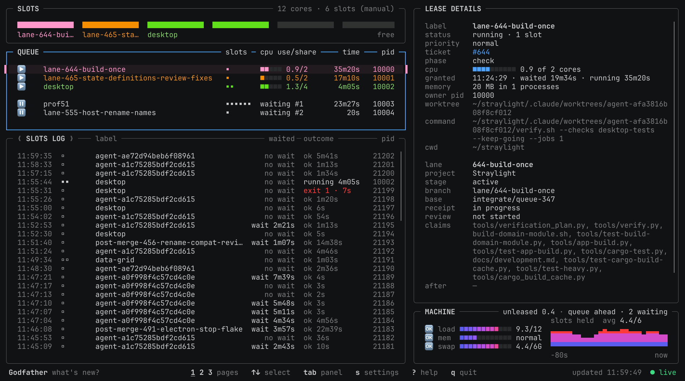

# fathers

Four small command-line tools for a development machine shared by several terminals, projects and coding agents.
Each is a separate package with its own version, changelog, documentation and tests, and installs on its own.

<picture>
  <source media="(prefers-color-scheme: light)" srcset="assets/dashboard-light.webp">
  
</picture>

| Package | What it does |
| --- | --- |
| [slotfather](slotfather) | One queue for expensive work: builds, tests and agents request machine capacity (slots) before starting. |
| [lanefather](lanefather) | Parallel changes in one Git repository: a worktree and a path claim per task, checks, one integration branch, review and cleanup. |
| [spawnfather](spawnfather) | Owns the long-lived processes and resources agents start, and ends them when their owner ends or their time is up. |
| [godfather](godfather) | One terminal dashboard for the three: their snapshots, settings and one merged event feed. |

The installed commands use only the Python standard library (3.11+) on macOS or Linux.

## Responsibilities

Each responsibility has one owner (fathers#171); the others ask it rather than keep a copy.

| Owner | Responsibility | What the others do |
| --- | --- | --- |
| Slotfather | **Capacity**: leases, the queue, admission and load. It reads processes (lease membership, CPU) and decides which leftovers its sweep may stop, but stops none itself. | `slotfather sweep --live` hands each tree it would stop to Spawnfather. |
| Lanefather | **Work**: a lane's worktree, claim, checks, integration and review, and when a lane's things are no longer needed. It removes nothing itself and keeps its own refusals (unlanded commits, the landing lock, fix lanes). | `start` registers the lane's worktree and folders with Spawnfather as owner `lane:<checkout>/<id>`; `done`, `drop` and `gc` ask it to reap them. Without Spawnfather, they refuse. |
| Spawnfather | **Lifetime**: owning, TTLs, stopping any process and removing any worktree or folder, behind one set of guards, and sweeping what no one owns. | Slotfather and Lanefather name a process by its identity (`{pid, started, cmd}`) or an owner, and Spawnfather checks again before it acts. |
| Godfather | **Showing all three**: their snapshots, settings and one event feed. It changes nothing but through their commands. | A lane's spawns join it by project and id; LANE DETAILS lists them. |
| `common/` | **Shared reading**: the one process-table reader (pid, start time and command, trees, groups, working directories), installed with each command. | Every tool reads processes through it; none signals through it. |

## Install

```sh
git clone https://github.com/maxvyshniakov/fathers.git
cd fathers
python3 install.py slotfather      # or lanefather, spawnfather, godfather; arguments after the name go to its installer
```

`python3 install.py PACKAGE` runs `PACKAGE/install.py`, which copies only that package into an immutable release and
swaps its command in one rename, so running commands keep their release. Each package's README has its options; a CI
runner installs Slotfather alone (`python3 slotfather/install.py --user runner --bin /usr/local/bin`).

## Layout

- `slotfather/`, `lanefather/`, `spawnfather/`, `godfather/`: one package each, with its own `install.py`, version,
  `CHANGELOG.md`, `README.md`, `GLOSSARY.md`, `docs/` and `tests/`, and the same lint gate, `tools/check.py`.
- `common/`: code the packages share today. It holds [`eventcheck.py`](common/eventcheck.py), the validator of the
  shared event schema that every package's tests import.
- `tools/`: the repository's check entry ([`checks.py`](tools/checks.py)) and its runner (`verify.py`), the
  pre-push gate (`prepush.py`), test hygiene (`hygiene.py`), Lanefather's verify command (`lane-check`) and the
  shared Ruff rules (`ruff.toml`).
- [`GLOSSARY.md`](GLOSSARY.md): the terms the tools share; each package's glossary holds its own.
- [`notes/sha-map.md`](notes/sha-map.md): the packages moved here from their own repositories with their history;
  the map gives the new commit for each old one.

Each triggered workflow tests on two GitHub-hosted Ubuntu runners: the package's minimum Python on Ubuntu 24.04
and the newest Python on ubuntu-latest. The [local gate](docs/agents/checks.md#full-gate) covers macOS.

## Develop

The checks are standard-library Python too; Ruff and Pyright come from `requirements-dev.txt` (on PATH or through
uv).

```sh
git config core.hooksPath .githooks   # once per clone: the pre-push gate
python3 tools/checks.py verify        # the checks of the packages changed since origin/main; FATHERS_CHECKS=all for every one
```

Each package's checks also run from its directory: `python3 tools/check.py` (Ruff and Pyright) and its tests.
[docs/agents/checks.md](docs/agents/checks.md) has the details.

## License

MIT, see [LICENSE](LICENSE).
