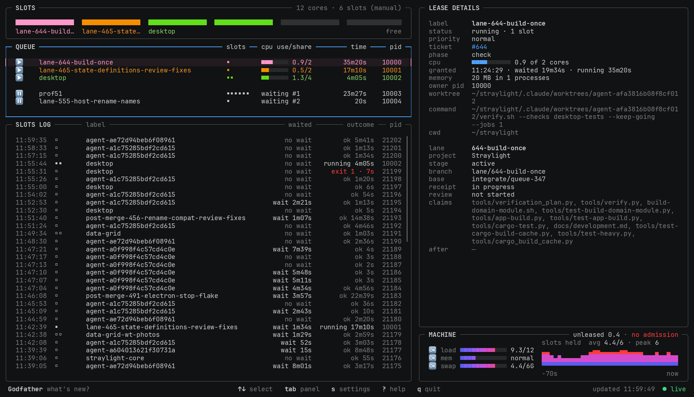

# godfather

One terminal dashboard for the tools that share a development machine:
[Slotfather](../slotfather) (capacity leases),
[Lanefather](../lanefather) (parallel agent lanes) and [Spawnfather](../spawnfather) (the long-lived
processes and resources agents spawn).

<picture>
  <source media="(prefers-color-scheme: light)" srcset="assets/dashboard-light.webp">
  
</picture>

**Status: 0.1.0, with the next release's work on `main`** ([SPEC.md, Status](SPEC.md#status) item by item,
[CHANGELOG.md](CHANGELOG.md) in full). The overview is Slotfather's dashboard as it moved here: SLOTS, QUEUE,
DETAILS, EVENTS and MACHINE. SLOTS' bottom border sums up the other tools, `2 lanes 3 active · 2 reviews` and
`3 spawns 7 · 1 orphan`; `2` and `3` (or a click on a summary) open the Lanes and Spawns pages, each a table, its
details and its tool's events. EVENTS shows one tool's log at a time, its title the switch (`❮ SLOTS LOG ❯`: ← →, `f`
or a click), one row per Slotfather run with trends as marks, its rows selectable into DETAILS, `/` to filter.
Enter, `a` or a right-click on a row offers the actions its tool advertises (reprioritize, ask to yield, reap,
extend, open, park), each checked against a fresh snapshot first. Settings (`s`) has a section per tool. MACHINE says
why admission is closed. `Godfather what's new?` (`v` or a click) opens one timeline of every tool's changelog.

## Install and run

Python 3.11 or later on macOS or Linux, standard library only.

```sh
git clone https://github.com/maxvyshniakov/fathers.git
cd fathers
python3 install.py godfather # ~/.local/bin/godfather, an entry point into an immutable release
godfather                   # the live dashboard: ? lists the keys, q quits
godfather --once --width 156 --height 43    # one frame as text (--color for escape sequences)
godfather events --follow   # the tools' events merged, newest last (--source NAME, --json: the lines as read)
```

Re-running the installer replaces the entry point atomically; a dashboard already running keeps its release and
shows `↻` in the footer. It is meant for workstations, not CI runners.

Refresh every and Colour theme (Settings, `s`) are kept in `~/.config/godfather/settings.json`.
`GODFATHER_THEME` (`auto`, `terminal`, `builtin`), `GODFATHER_TERMINAL_BG` and `_FG` set the theme inputs; the
`SLOTFATHER_` names still work where the new ones are unset.

## How the tools talk to it

Godfather reads; the tools own their state. It never imports a tool's code and never reads a tool's state files: it
runs their CLIs. A tool that is not installed simply has no panels; one without the contract is named in one panel.

| Contract | Command or file |
| --- | --- |
| Discovery | `<tool> capabilities --json` |
| Snapshot | `slotfather status --json --full`, polled every Refresh every |
| Settings | `<tool> settings --json`, `settings check`, `settings set`, `settings reset`, for each present tool |
| Events | `events.jsonl` in the tool's state directory, one shared versioned schema |

[docs/contracts/slotfather.md](docs/contracts/slotfather.md) is the exact shape read from Slotfather,
[docs/contracts/lanefather.md](docs/contracts/lanefather.md) from Lanefather, and
[docs/contracts/spawnfather.md](docs/contracts/spawnfather.md) from Spawnfather;
[docs/contracts/changelog.md](docs/contracts/changelog.md) is what every tool answers for what's new.
The event schema is [docs/events.md](docs/events.md), with a JSON Schema and
[`common/eventcheck.py`](../common/eventcheck.py), one MIT-licensed standard-library file every tool's tests
import:

```sh
python3 common/eventcheck.py --strict ~/.local/state/slotfather/events.jsonl
```

Godfather reads the logs with a packaged copy of that validator (`src/godfather/eventcheck.py`, kept byte for byte
the same by `tests/test_events.py`), because an installed command cannot import from the repository.

## Develop

```sh
python3 -m unittest discover -s tests -t tests     # unit, golden, fixture and live PTY tests
python3 tools/check.py                              # Ruff and strict Pyright against tools/type-baseline.json
python3 tools/goldens.py                            # rewrite tests/goldens/ after a deliberate visible change
python3 tools/dashboard-demo.py                     # the README scene, live; --screenshot / --animation: media
python3 tools/raster.py --goldens OUTDIR            # every golden screen as a PNG, for review
python3 tools/compare_media.py OLD.png NEW.png OUT.png  # cell-by-cell screenshot diff, side by side
```

Pictures come from `tools/raster.py` (Pillow, in requirements-dev.txt), with no terminal or browser: it draws the
colour text Godfather prints, box drawing and blocks as geometry snapped to the cell and emoji from the system's
colour emoji font, the same pixels for the same cells. A live screen:
`godfather --once --color --width 100 --height 40 | python3 tools/raster.py - screen.png`.

`GODFATHER_FIXTURES=DIR` replaces every tool call with recorded replies (`tests/fixtures/scene/` is the README
scene) and records writes instead of making them.

## Versions

[CHANGELOG.md](CHANGELOG.md) uses the Sid-Kit format: one `## Unreleased`, then `## x.y.z - YYYY-MM-DD`, newest
first, with sections only when they have entries, in the order Breaking, Added, Changed, Deprecated, Removed,
Fixed, Security. Before 1.0 a breaking or broad behaviour change takes a minor version, anything else a patch.
