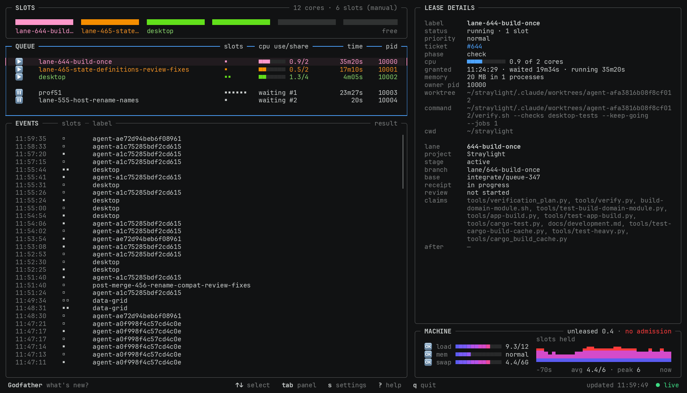

# godfather

One terminal dashboard for the tools that share a development machine:
[Slotfather](../slotfather) (capacity leases),
[Lanefather](../lanefather) (parallel agent lanes) and junkfather (the long-lived
processes agents start).

<picture>
  <source media="(prefers-color-scheme: light)" srcset="assets/dashboard-light.webp">
  
</picture>

**Status: 0.1.0.** The main screen is Slotfather's dashboard, moved here with no visible change but the footer:
`Godfather  what's new?` (`v` or a click) opens one timeline of every tool's changelog, an install from main's
unreleased entries included. Lanes, processes, the merged event feed and row actions come in the next slices of
[SPEC.md](SPEC.md), each as its tool supports the contract.

## Install and run

Python 3.9 or later on macOS or Linux, standard library only.

```sh
git clone https://github.com/maxvyshniakov/fathers.git
cd fathers
python3 install.py godfather # ~/.local/bin/godfather, an entry point into an immutable release
godfather                   # the live dashboard: ? lists the keys, q quits
godfather --once --width 156 --height 43    # one frame as text (--color for escape sequences)
```

Re-running the installer replaces the entry point atomically; a dashboard already running keeps its release and
shows `↻` in the footer. It is meant for workstations, not CI runners.

Refresh every and Colour theme (Settings, `s`) are kept in `~/.config/godfather/settings.json`.
`GODFATHER_THEME` (`auto`, `terminal`, `builtin`), `GODFATHER_TERMINAL_BG` and `_FG` set the theme inputs; the
`SLOTFATHER_` names still work where the new ones are unset.

## How the tools talk to it

Godfather reads; the tools own their state. It never imports a tool's code and never reads a tool's state files: it
runs their CLIs. A tool that is not installed simply has no panels; one without the contract is named in one panel.

| Contract | Command or file |
| --- | --- |
| Discovery | `<tool> capabilities --json` |
| Snapshot | `slotfather status --json --full`, polled every Refresh every |
| Settings | `slotfather settings --json`, `settings check`, `settings set`, `settings reset` |
| Events | `events.jsonl` in the tool's state directory, one shared versioned schema |

[docs/contracts/slotfather.md](docs/contracts/slotfather.md) is the exact shape read from Slotfather;
[docs/contracts/changelog.md](docs/contracts/changelog.md) is what every tool answers for what's new.
The event schema is [docs/events.md](docs/events.md), with a JSON Schema and
[`common/eventcheck.py`](../common/eventcheck.py), one MIT-licensed standard-library file every tool's tests
import:

```sh
python3 common/eventcheck.py --strict ~/.local/state/slotfather/events.jsonl
```

## Develop

```sh
python3 -m unittest discover -s tests -t tests     # unit, golden, fixture and live PTY tests
python3 tools/check.py                              # Ruff and strict Pyright against tools/type-baseline.json
python3 tools/goldens.py                            # rewrite tests/goldens/ after a deliberate visible change
python3 tools/dashboard-demo.py                     # the README scene, live; --screenshot / --animation: media
python3 tools/compare_media.py OLD.png NEW.png OUT.png  # cell-by-cell screenshot diff, side by side (needs Pillow)
```

`GODFATHER_FIXTURES=DIR` replaces every tool call with recorded replies (`tests/fixtures/scene/` is the README
scene) and records writes instead of making them. `tests/test_parity.py` compares Godfather, cell by cell but the
footer and EVENTS, with Slotfather's in-tree dashboard on Slotfather's own demo scene, from the same model; that
dashboard is gone upstream, so its output is a frozen fixture from Slotfather 37c4df7
([tests/fixtures/parity/](tests/fixtures/parity)).

## Versions

[CHANGELOG.md](CHANGELOG.md) uses the Sid-Kit format: one `## Unreleased`, then `## x.y.z - YYYY-MM-DD`, newest
first, with sections only when they have entries, in the order Breaking, Added, Changed, Deprecated, Removed,
Fixed, Security. Before 1.0 a breaking or broad behaviour change takes a minor version, anything else a patch.
